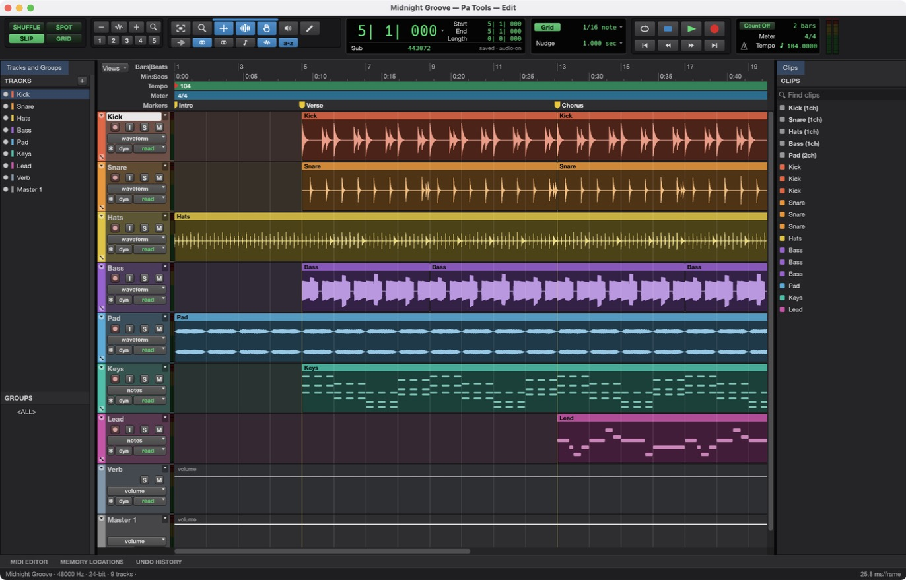
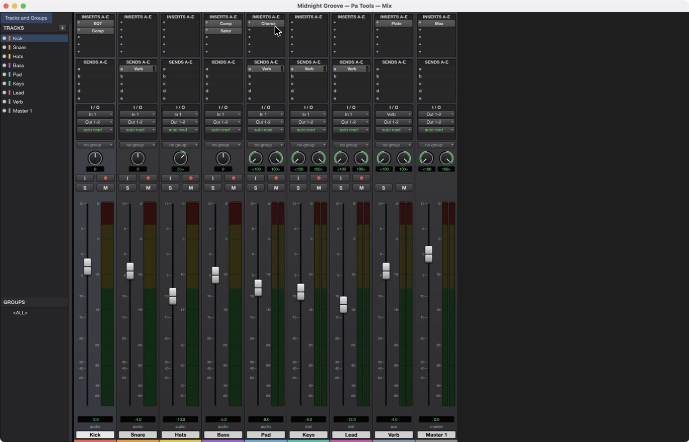

# Pa Tools

**A professional multitrack audio workstation, native and open source, built in pure Rust.**

Pa Tools is the DAW of the PA app family from [GR8 ID YUZ.AI](https://gr8idyuz.ai) (Images Couture).
It records, edits and mixes audio and MIDI in an Edit window and a Mix window, hosts CLAP, VST3 and
Audio Unit plugins, plays video against the timeline, and exposes every action to the command line
and to AI agents. It runs natively on macOS (Apple silicon and Intel), Windows, Linux and FreeBSD,
and in the browser.

> **Pre-alpha.** Pa Tools is a fork of [SoundCraft](https://github.com/storytold/soundcraft) by the
> ArtCraft team and the SoundCraft contributors (fork point: SoundCraft 0.11.0, commit `9b8283b`).
> Almost all of the engine, editor and mixer is their work, and we are grateful for it. What Pa Tools
> changes is described in [`UPSTREAM.md`](UPSTREAM.md).

<p align="center">
  
  <br>
  <sub>The Edit window playing the built-in demo song (every sound in it is synthesised by the app itself).
  The screenshots in this repository still show the upstream SoundCraft name in the menu bar; they will
  be replaced with Pa Tools captures.</sub>
</p>

<p align="center">
  <a href="#what-it-does">What it does</a> ·
  <a href="#getting-started">Getting started</a> ·
  <a href="#build-from-source">Build</a> ·
  <a href="#for-agents-and-scripts">Agents &amp; scripts</a> ·
  <a href="#how-its-built">How it's built</a> ·
  <a href="#status-and-roadmap">Status</a> ·
  <a href="#downloads">Downloads</a> ·
  <a href="#license-and-credits">License</a>
</p>

## What it does

Pa Tools follows the workflow audio engineers already know: an **Edit window** for arranging and
editing, a **Mix window** for balancing, edit modes, tools, playlists, memory locations, offline
processing and the rest.

<table>
  <tr>
    <td width="50%"></td>
    <td width="50%"></td>
  </tr>
  <tr>
    <td><b>Mix window.</b> Ten inserts and ten sends per track, busses and aux inputs, master faders, VCAs, routing folders, solo-in-place with implicit solo, and meters with peak hold.</td>
    <td><b>MIDI editor.</b> Instrument tracks with built-in synths, a piano roll with a velocity lane, step input, quantize, transpose, and Standard MIDI File import and export.</td>
  </tr>
  <tr>
    <td width="50%"></td>
    <td width="50%"></td>
  </tr>
  <tr>
    <td><b>Automation and markers.</b> Breakpoint automation for volume, pan, mute, sends and every plugin parameter, written live in Write, Touch and Latch, plus memory locations and a big counter.</td>
    <td><b>Video.</b> A picture track with thumbnails and a Video window that follows the playhead, decoding H.264, ProRes and Motion JPEG in pure Rust, with timecode burn-in and sync offset.</td>
  </tr>
  <tr>
    <td width="50%"></td>
    <td width="50%"></td>
  </tr>
  <tr>
    <td><b>Surround and immersive.</b> Main and bus formats from stereo to 9.1.6 and Ambisonics, a surround panner with divergence and height, object/bed routing and a Renderer window with live speaker levels.</td>
    <td><b>Notation.</b> A Score Editor for MIDI tracks, MusicXML export for notation programs, and printable engraved scores. <b>Your plugins too:</b> CLAP, VST3 and Audio Units, with their own editors and their state saved in the session.</td>
  </tr>
</table>

### Feature tour

- **Editing:** Shuffle, Slip, Spot and Grid modes; Smart, Selector, Grabber, Trim, Pencil, Zoom and
  Scrubber tools; cut, copy, paste, duplicate, repeat, shift, insert silence, separate (at
  selection, on grid, at transients), heal, consolidate, strip silence, nudge; fades and
  crossfades in five shapes; playlists with comping lanes; clip gain lines; edit groups; undo for
  everything.
- **Mixing:** fader and pan with automation, pre/post sends, busses, aux inputs, master faders,
  VCA masters, routing folders, solo modes, mute and solo groups, phase invert and trim, clip
  effects, and automatic plugin delay compensation.
- **Automation:** volume, pan, mute, send and every plugin parameter; Write, Touch, Latch and
  Trim passes recorded live from the faders; thin, glide, coalesce and convert to clip gain.
- **Plugins:** EQ, compressor/limiter, expander/gate, de-esser, maximizer, channel strip, room and
  plate reverbs, mod delay, chorus, flanger, phaser, saturator, lo-fi, pitch shifter, time shift,
  utilities, a subtractive synth, a drum synth and a sampler, all original. CLAP, VST3 and Audio
  Unit plugins load too. Any processor runs offline, and user presets save per plugin.
- **MIDI:** instrument and MIDI tracks, a piano-roll editor with a velocity lane, an event list, a
  score view, step input, quantize, transpose, Standard MIDI Files, and Audio-to-MIDI from a sung or
  played melody.
- **Recording:** punch in on a selection or on the fly, pre/post-roll, loop recording with a
  playlist per take, input monitoring through the full channel strip, and autosave with recovery.
- **Time and tempo:** Bars|Beats, Min:Secs, Timecode (every rate, drop-frame included),
  Feet+Frames and Samples; tempo and meter maps; key signatures and detected chords; beat
  detection; pitch-preserving warping.
- **Audio files:** WAV/BWF/RF64, AIFF/AIFC and FLAC in and out; MP3, Ogg Vorbis, AAC, ALAC, CAF
  and the audio of MP4/MOV movies in. Any sample rate and bit depth. MP3 export is planned through
  a separate LGPL FFmpeg sidecar, not linked into the app.
- **Bounce:** mix or stems to WAV, AIFF or FLAC at 16/24/32-bit float with dither and
  normalisation, reporting peak, true peak and integrated loudness (LUFS).
- **Panels:** Tracks and Groups, Clips, MIDI Editor, Memory Locations and Undo History are movable
  panels. Edit and Mix keep separate arrangements. Drag a panel header to a target edge or another
  header; its context menu offers Float panel, Move to group and Close panel, and Reset Panel Layout
  restores the default layout.
- **Fast:** a parallel mix engine, copy-on-write undo, and a UI that holds 120 frames per second
  with seventy-odd tracks playing.

## Getting started

Download a build from the releases page (see [Downloads](#downloads)), or build from source below.
Start the app with the built-in demo song to look around: `pa-tools --demo`.

Useful shortcuts: <kbd>Space</kbd> play/stop, <kbd>⌘</kbd><kbd>=</kbd> Mix/Edit,
<kbd>F1</kbd>–<kbd>F4</kbd> edit modes, <kbd>F5</kbd>–<kbd>F10</kbd> tools, <kbd>⌘</kbd><kbd>E</kbd>
separate, <kbd>⌘</kbd><kbd>D</kbd> duplicate, <kbd>Enter</kbd> new marker, <kbd>⌘</kbd><kbd>⇧</kbd><kbd>N</kbd>
new tracks. **Setup › Keyboard Shortcuts** lists them all.

### Logs

The desktop app writes its `log` records to standard error and to `logs/patools.log` in the
settings directory, beside `ui.json`, `Autosave/` and `Presets/` (macOS
`~/Library/Application Support/Pa Tools/`; Windows `%APPDATA%\Pa Tools\`; Linux
`$XDG_CONFIG_HOME/patools/` or `~/.config/patools/`). A start from a desktop menu or the Dock has no
terminal, so this file is what to attach to a bug report. Each launch moves the previous log to
`patools.1.log` (and that one to `patools.2.log`), and the file stops growing at 16 MiB.
`SOUNDCRAFT_CONFIG_DIR` overrides the settings directory and `SOUNDCRAFT_NO_PREFS` runs without
reading or writing preferences or a log file.

| Variable | Effect |
|---|---|
| `RUST_LOG` | Log levels for standard error and the log file. Default: `info` for the app's own crates, `warn` for everything else. env_logger-style directives replace that, e.g. `RUST_LOG=debug` or `RUST_LOG=warn,soundcraft_mix=trace`. |
| `SOUNDCRAFT_NO_PREFS` | No preferences read or written and no log file (agents' test runs). |
| `SOUNDCRAFT_CONFIG_DIR` | Use this directory as the settings directory. |

The `SOUNDCRAFT_*` variable names are inherited from upstream and keep working; see
[`UPSTREAM.md`](UPSTREAM.md). The crate names (`soundcraft-engine`, `soundcraft_mix`, ...) and the
`.scraft` session extension are inherited too, so Pa Tools opens upstream sessions and the other way
round.

## Build from source

Requirements: **Rust 1.95 or newer** for the desktop and web UI (the core workspace's declared
minimum is 1.90), and network access: Cargo fetches two small git dependencies, `craft-ui` and
`craft-docpath`, from `github.com/storytold/craft-libs` (both MIT OR Apache-2.0; see `UPSTREAM.md`).

```sh
git clone <this repository>
cd <this repository>
cargo run --release -p soundcraft -- --demo     # builds the `pa-tools` binary and opens the demo song
```

The Cargo packages keep their upstream names (`soundcraft`, `soundcraft-cli`, `soundcraft-web`), so
`-p soundcraft` selects the desktop app; the binaries it produces are **`pa-tools`** and
**`pa-tools-cli`**. `cargo xtask ci` runs formatting, clippy, the tests, the asset and layering
checks and the WebAssembly build.

### macOS: Intel, Apple silicon, universal

Nothing in the source is architecture-specific. You need a Mac with the Xcode Command Line Tools
(`codesign`, `lipo`, `hdiutil`, `plutil`, `ditto` and `xcrun` are used by the packaging script).

```sh
# Intel Mac (x86_64 is the host target): run from source
cargo build --release --locked -p soundcraft -p soundcraft-cli
target/release/pa-tools --demo

# Intel-only DMG and CLI zip (ad-hoc signed, for your own machine)
packaging/macos/package.sh --arch x86_64
# -> dist/release/patools-<version>-macos-x86_64.dmg, pa-tools-cli-<version>-macos-x86_64.zip

# Apple silicon only
packaging/macos/package.sh --arch aarch64

# Universal (default); both Rust targets are needed
rustup target add aarch64-apple-darwin x86_64-apple-darwin
packaging/macos/package.sh --arch universal
```

Without `MACOS_SIGN_IDENTITY` the app is signed ad hoc with the hardened runtime. That is enough to
run it on the Mac that built it, and `packaging/macos/entitlements.plist` includes
`com.apple.security.cs.disable-library-validation` so third-party VST3, CLAP and Audio Unit bundles
still load. Other Macs need a Developer ID identity and notarization (`APPLE_ID`, `APPLE_PASSWORD`,
`APPLE_TEAM_ID`). The icon `assets/app-icon/Pa Tools.icns` is committed; to rebuild it on a Mac run
`iconutil -c icns "assets/app-icon/Pa Tools.iconset"`.

### Windows

Needs Rust with the MSVC toolchain, the Windows SDK, and WiX v5
(`dotnet tool install --global wix --version 5.0.2`).

```powershell
cargo run --release -p soundcraft -- --demo
pwsh packaging/windows/package.ps1 -Arch x64      # also x86, or arm64 (cross-compiled; needs the MSVC ARM64 build tools)
# -> dist\release\patools-<version>-windows-<arch>.msi and ...-portable.zip
```

The script links the C runtime statically, so no Visual C++ redistributable is needed. Installers
are unsigned unless `WINDOWS_CERTIFICATE` or the `AZURE_*` signing variables are set.

### Linux and FreeBSD

Needs the ALSA headers (`libasound2-dev` on Debian/Ubuntu, `alsa-lib-devel` on Fedora) and
`pkg-config`. X11, Wayland, Vulkan and EGL are loaded at runtime.

```sh
cargo run --release -p soundcraft -- --demo
packaging/linux/package.sh --formats "tar deb"     # AppImage, deb, rpm, tar.gz; deb/rpm need nfpm
# -> dist/release/patools-<version>-linux-<arch>.*
packaging/freebsd/package.sh                       # on FreeBSD
```

### Web

```sh
cd apps/soundcraft-web && trunk serve --release    # then open http://127.0.0.1:8080
packaging/web/package.sh                           # -> dist/release/patools-web-<version>.zip
```

## For agents and scripts

Everything you can click is also a command with an id and JSON parameters, and the same commands
are reachable from the menus, the keyboard, the command line, a JSON control channel and an
[MCP](https://modelcontextprotocol.io) server. Programmatic calls never open dialogs, and
`session.inspect` reports exactly what changed, so an agent can check its own work.

```sh
# Headless: load the demo, turn the kick down, add an EQ, bounce.
pa-tools-cli run --demo \
  --cmd 'mix.volume={"track":"Kick","db":-6}' \
  --cmd 'mix.insert={"track":"Bass","plugin":"eq_7band"}' \
  --bounce mix.wav

# Drive the running app.
pa-tools --demo --control 7801 &
pa-tools-cli app --port 7801 transport.play
pa-tools-cli app --port 7801 ui.screenshot '{"path":"shot.png"}'

# Give Claude (or any MCP client) a DAW.
claude mcp add pa-tools -- pa-tools-cli mcp --demo

# Or keep the agent to some folders (reads and writes are separate roots).
pa-tools-cli mcp --automation-read-root DIR --automation-write-root DIR
```

See [`docs/control-protocol.md`](docs/control-protocol.md) and [`docs/mcp.md`](docs/mcp.md).
`pa-tools-cli commands` lists every command.

## How it's built

Pa Tools is a Cargo workspace of small crates with strict layering: nothing below the UI knows
about egui, so the interface could be swapped for another one.

| Crate | What it does |
|---|---|
| `soundcraft-time` | Timebases, tempo and meter maps, timecode, grid |
| `soundcraft-audio-io` | Audio file formats and waveform overviews |
| `soundcraft-midi` | Standard MIDI Files and MIDI operations |
| `soundcraft-dsp` | Plugins, offline processing, meters, loudness, FFT |
| `soundcraft-model` | The session document |
| `soundcraft-mix` | The mix engine (realtime and offline share it) |
| `soundcraft-engine` | Commands, undo, editing, import/export, bounce |
| `soundcraft-playback` | Audio devices (CoreAudio, WASAPI, ALSA, WebAudio) and recording |
| `soundcraft-automation` | MCP server and control-channel client |
| `soundcraft-ui-egui` | The user interface |

The crates keep their upstream names on purpose, so that merging upstream stays cheap
([`UPSTREAM.md`](UPSTREAM.md)). The code never panics on bad input: errors are values, and a
malformed file or a bad agent call produces a message, never a crash. Contributor and agent
rules are in [`AGENTS.md`](AGENTS.md), the architecture in [`docs/architecture.md`](docs/architecture.md).

## Status and roadmap

Pa Tools is **pre-alpha**. Record, edit, mix and bounce work end to end; the main open items are
choosing an audio interface and buffer size, recording MIDI from a controller, session interchange
(AAF/OMF), signed third-party plugin loading on macOS (the entitlement is in place, verification on a
Mac is pending), MP3 export, and translations. The stage and effort estimates are in
[`ROADMAP.md`](ROADMAP.md); the assessment is in [`docs/target-app-parity.md`](docs/target-app-parity.md),
the ranked list of gaps in [`docs/gaps.md`](docs/gaps.md), and the menu-by-menu comparison in
[`docs/parity-checklist.md`](docs/parity-checklist.md).

## Downloads

Release artifacts are named `patools-<ver>-<platform>-<arch>.<ext>`, with `<ver>` the version number.
The release page is a placeholder until the repository location is final:
`https://github.com/gilbertriv-ux/pa-tools/releases`. Release CI is described in
[`docs/ci-notes-patools.md`](docs/ci-notes-patools.md); until it is vendored, build the artifacts
locally with the `packaging/` scripts above.

| Platform | Files |
|---|---|
| macOS | `patools-<ver>-macos-<arch>.dmg`, `pa-tools-cli-<ver>-macos-<arch>.zip` (`<arch>`: `x86_64`, `aarch64` or `universal`) |
| Windows | `patools-<ver>-windows-<arch>.msi` and `patools-<ver>-windows-<arch>-portable.zip` (`x64`, `arm64`, `x86`) |
| Linux | `patools-<ver>-linux-<arch>.AppImage`, `.deb`, `.rpm`, `.tar.gz`, `.flatpak` (`x86_64`, `aarch64`) |
| FreeBSD | `patools-<ver>-freebsd-x86_64.tar.gz` |
| Web | `patools-web-<ver>.zip` |

**If the app doesn't open on Windows:** the desktop app initializes only DirectX 12 by default,
because letting wgpu also create an OpenGL instance can crash some graphics drivers (AMD's
`atio6axx.dll`) before the window appears. `WGPU_BACKEND` overrides the default for troubleshooting
(for example `dx12` or `vulkan`). In PowerShell, from the folder containing the executable:

```powershell
$env:WGPU_BACKEND = "vulkan"
& .\pa-tools.exe
Remove-Item Env:WGPU_BACKEND                     # restore the default for later launches
```

DirectX 12 shaders are compiled with FXC, which is part of Windows, so no `dxcompiler.dll` or
`dxil.dll` is needed. `$env:WGPU_DX12_COMPILER = "dxc"` (or `"auto"`) selects wgpu's DXC handling
again for troubleshooting.

## License and credits

Pa Tools is dual-licensed under [MIT](LICENSE-MIT) or [Apache-2.0](LICENSE-APACHE), at your option,
the same terms as the project it is based on. Copyright (c) 2026 GR8 ID YUZ.AI for the changes made in
Pa Tools, and Copyright (c) 2026 ArtCraft Team and the SoundCraft contributors for SoundCraft. Required
notices are in [NOTICE](NOTICE).

**Pa Tools is based on [SoundCraft](https://github.com/storytold/soundcraft) by the ArtCraft team.**
Thank you to everyone who built it. Pa Tools is not an ArtCraft product and is not endorsed by the
ArtCraft team. How the fork is kept in step with upstream is in [`UPSTREAM.md`](UPSTREAM.md).

Bundled fonts, icons, images and other assets keep their own open licenses; each one is listed with
its author, source and license in [ATTRIBUTION.md](ATTRIBUTION.md). Every icon in the interface is
drawn in code, the app icon is original, and the demo song is synthesised by the app itself, so there
are no samples or artwork from anyone else in this repository.
